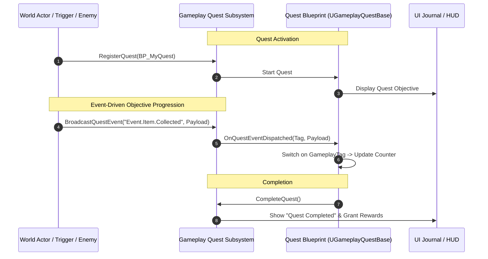

# Gameplay Quest System for Unreal Engine 5

[](https://www.unrealengine.com/)
[](README.md)
[](LICENSE)
[](https://www.linkedin.com/in/shankharaj-datta-45921a28a/)
[](#blueprint-workflow-quickstart)
[](#system-architecture)

A lightweight, designer-friendly, event-driven quest framework for Unreal Engine 5 (UE 5.3). Built from the ground up to centralize quest state management and eliminate hard asset references between mission logic and gameplay actors.

> [!TIP]
> **Zero Compilation Required for Blueprint Users**: Pre-compiled Win64 editor binaries (`.dll` + `.modules`) are included in the repository. Drop into `Plugins/` and start creating quests immediately!

---

## ✨ Features & Architectural Highlights

- 🎯 **Centralized Quest Flow via `UGameplayQuestBase`**: Modular quest actors with clean lifecycle hooks.
- ⚡ **Three Core Native Overrides**:
  - `Start Quest` — Triggered when a quest is registered/activated.
  - `Complete Quest` — Called when all objective conditions are satisfied; handles rewards and state progression.
  - `Reset Quest` — Reverts progress cleanly for repeatable or failed quests.
- 🏛️ **Game Instance Subsystem Hub (`UGameplayQuestSubsystem`)**: Global registration, persistence across level streaming, and event distribution.
- 🏷️ **Tag-Driven Event Dispatching**: World actors broadcast loose `GameplayTags` (`Event.Item.Collected`, `Event.Enemy.Defeated`), decoupling quests from specific enemy or item classes.
- 🎨 **Designer-First**: 100% Blueprint-compatible with custom async latent actions (`QuestAsyncListen`, `QuestAsyncRegister`).

---

## 🏛️ System Architecture



---

## 🚀 Blueprint Workflow (Quickstart)

### 1. Create Your Quest Blueprint
1. Right-click in the Content Browser > **Blueprint Class**.
2. Expand **All Classes**, search for and select `GameplayQuestBase` (e.g., `BP_FetchApplesQuest`).
3. Open your new blueprint and override the three native events:
   - **`Start Quest`** → Initialize target counters, play dialogue, or add an objective widget.
   - **`Complete Quest`** → Grant rewards, play fanfare, advance storyline.
   - **`Reset Quest`** → Clear progress or reset checkpoints.

### 2. Register & Start the Quest
Anywhere in your game (NPC interaction, dialog tree, level trigger):
```text
Get Game Instance Subsystem (GameplayQuestSubsystem)
  └── Call "Register Quest" [Quest Class: BP_FetchApplesQuest]
        └── Call "Start Quest" on the returned Quest Reference
```

### 3. Broadcast World Events
When a player collects an item, defeats an enemy, or enters a trigger volume:
```text
Get Game Instance Subsystem (GameplayQuestSubsystem)
  └── Call "Broadcast Quest Event"
        ├── Event Tag: "Event.Item.Collected"
        └── Payload: Actor / Quantity / Custom Data
```

### 4. Respond to Events in Your Quest BP
Inside your quest blueprint:
- Bind to quest event callbacks or implement custom tag evaluation.
- Use **Switch on Gameplay Tag** to route logic cleanly without casting to world actors.

---

## 📋 Requirements & Compatibility

| Requirement | Specification |
| :--- | :--- |
| **Engine Version** | Unreal Engine 5.3 |
| **Required Plugins** | `GameplayTags` (Enabled by default in UE5) |
| **Target Platforms** | Win64 (Tested and Verified) |
| **Binaries** | Pre-compiled Win64 editor DLLs included |

---

## 📥 Sample Project Showcase

A fully configured sample project demonstrating quest givers, collect objectives, kill counters, and UI journal integration is available:

👉 **[Download Sample Quest System Project (Google Drive)](https://drive.google.com/drive/folders/1N2vbHkmcZg7wRXJsU60csybFuRw8tn6X?usp=sharing)**

---

## 📄 License & Attribution

Distributed under the **MIT License**. See [LICENSE](LICENSE) for details.

Created by **[Shankharaj Datta](https://www.linkedin.com/in/shankharaj-datta-45921a28a/)**.
